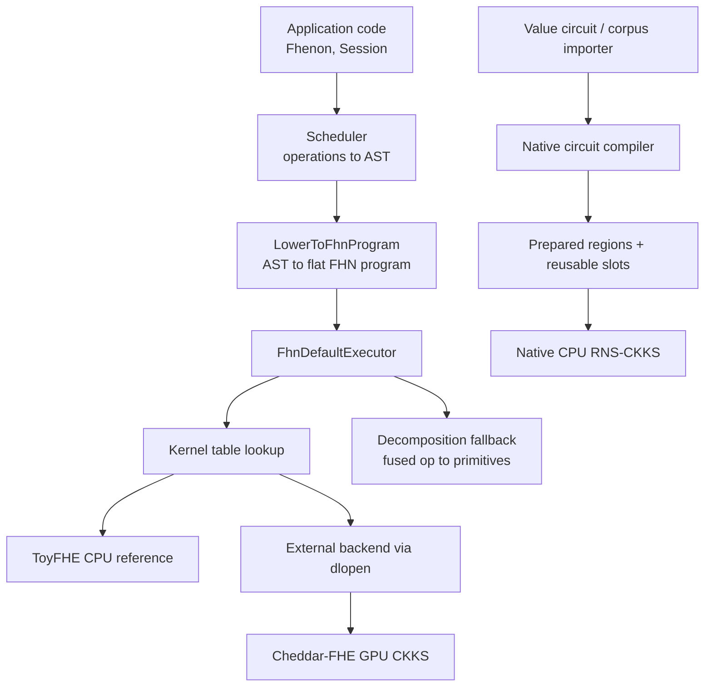

# FHENOMENON: A Catalyst for Enabling Practical Fully Homomorphic Encryption Programming Model

Fhenomenon is an early C++17 systems project for a practical, FHE-native programming model.

Its intended contribution model is broad: independently supplied kernels at
different granularities should compete and compose to execute high-level
programs under explicit application requirements. The
[lightweight runtime](docs/lightweight-runtime.md) executes registered recipes
immediately and retains shared intermediate artifacts across commands. Native
CKKS rotation preparation is one implemented example; the existing circuit
compiler attaches only to explicitly requested regions. The earlier global
planning proposal is superseded. Automatic whole-program optimization and
CGGI↔CKKS/BFV switching are not implemented.

[Contributed statistics and packed-dot kernels](docs/coarse-statistics-kernels.md)
demonstrate larger native kernels sharing ordinary intermediate values through
this API, without changes to either runtime core or native adapter.
[Prepared matvec kernels](docs/matvec-preparation.md) additionally share explicit
source/key companions across commands while preserving the original formula and
ciphertext residues; [measurements](docs/matvec-preparation-validation-2026-10-31.md)
include component comparisons, preparation cost and retained memory.

The core bet is simple: fully homomorphic encryption will not become practical by pretending that arbitrary software can be compiled unchanged into encrypted execution. It will also not become practical by making every backend maximally general and then accepting unusable speed. The useful boundary is closer to GPU computing. A trusted host should orchestrate public control flow, while an untrusted executor runs branchless, data-oblivious, coarse-grained encrypted kernels.

Fhenomenon treats constraints as performance contracts. A fast kernel that only works for a particular scheme, parameter set, packing layout, tensor shape, device residency, or application pattern is not a second-class hack. It is a valuable fast path, as long as its constraints are explicit enough for the runtime to dispatch, compose, benchmark, and replace it safely.

This repository is building the small runtime and backend interface for that world.

- An immediate recipe runtime with shared resource identities, dependencies,
  retained-memory budgets, and bounded dispatch diagnostics.
- Optional semantic circuit compilation for explicitly selected native regions.
- A flat FHN program IR for explicit kernel dispatch and reference execution.
- A C ABI kernel table that FHE library and hardware developers can extend without learning a complex compiler pipeline.
- A default executor that dispatches kernels and decomposes fused opcodes when a backend only exposes primitives.
- Optional async backend hooks for accelerator-oriented submission, polling, waiting, and output collection.
- A native CPU RNS-CKKS backend with public-key encryption, packed real arithmetic, hybrid key switching, and a separate trusted client.
- A self-contained ToyFHE reference backend for CI, examples, and backend-author education.
- An external backend loader and an optional Cheddar-FHE GPU CKKS backend.

Fhenomenon is not production cryptography yet, and it is not a complete industrial platform. It is an engineering scaffold for finding the right offloading boundary between application code, encrypted kernels, and accelerator-aware orchestration.

For the design argument behind the project, see [Convergent Evolution: Why Secure Homomorphic Encryption Will Resemble High-Performance GPU Computing](https://ckks.org/test/2025-08-07-convergent-evolution/).

## Why This Exists

FHE is theoretically general, but practical secure execution is not shaped like normal software.

Secret-dependent branches, early exits, adaptive memory access, and pruning-heavy algorithms must either leak information or be converted into fixed, data-oblivious work. That usually means:

- both sides of a secret branch are evaluated;
- loops need public bounds;
- memory access patterns must be uniform or made oblivious at significant cost;
- performance comes from packing, batching, and fused kernels, not from skipping work.

So Fhenomenon does not start with "compile any program." It starts with a narrower and, we think, more realistic systems contract:

```text
Trusted host
  owns application control flow, public scheduling, keys, policies

Public circuit or FHN program
  application value graph, or explicit encrypted-kernel instructions

Secure kernel executor
  runs branchless FHE kernels through a backend-specific implementation
```

This makes Fhenomenon closer to a CUDA-like runtime boundary for FHE than to a universal source-to-FHE compiler.

Execution boundaries follow the application and backend constraints. The opcode table is a convenient integration surface; it does not make multiplication, relinearization, rescale, or their named composites atomic execution units. The native circuit path can combine a complete affine expression or sum of ciphertext products, choose a level schedule, and reuse intermediate storage. Progress is measured by correctly executed applications and their complete evaluation time under fixed parameters and accuracy requirements.

## Current Status

The repository already contains the first version of that boundary.

| Area | Status |
| --- | --- |
| Circuit compiler | Optional `fhn_circuit_api.h`: copied value graphs, affine/quadratic regions, prepared public keys, reusable slots, allocation-free repeated execution. See [circuit execution](docs/circuit-execution.md). |
| FHN IR | Implemented in `include/FHN/fhn_program.h` as a flat C ABI instruction array. |
| Backend ABI | Implemented in `include/FHN/fhn_backend_api.h`: `fhn_get_info`, `fhn_create`, `fhn_destroy`, `fhn_get_kernels`, plus a host-side data plane (`fhn_buffer_alloc/free`, optional `fhn_encrypt_*`/`fhn_decrypt_*`). Key-consuming operations are not kernel-table entries and cannot appear in an `FhnProgram`. |
| Default executor | Implemented in `FhnDefaultExecutor`; dispatches kernel-table entries and decomposes fused operations such as `FHN_HMULT`. |
| Native CKKS backend | `ckks_fhn`: genuine CPU leveled RNS-CKKS, canonical packing, public-key encryption, relinearization, rescale and rotations. The evaluator has no secret-key reference. See [native CKKS](docs/native-ckks.md). |
| ToyFHE backend | Implemented as a CPU reference backend. Useful for tests and examples, not secure. |
| External backend loading | Implemented with `dlopen` for Linux/macOS style shared libraries. |
| Cheddar-FHE backend | Optional GPU CKKS backend under `src/FHN/cheddar`, built only when the Cheddar submodule and CUDA-facing dependencies are available. |
| Async backend hooks | `fhn_submit`, `fhn_poll`, `fhn_wait`, `fhn_get_outputs`, and `fhn_exec_free` are defined as optional exports and resolved by `ExternalBackend`; the default executor is still primarily synchronous. |
| Scheduler lowering | `LowerToFhnProgram` lowers scheduler ASTs into FHN programs. `Session::run` executes a recorded scope through that same path — lower, plan movement, dispatch — so scoped execution is the FHN path rather than an alternative to it. See [Scoped Execution](#scoped-execution). |
| TFHE-rs experiment | A separate Rust FFI experiment exists for integer operations when `BUILTIN_BACKEND=TFHE`. |

The default build produces both the native CKKS plugin and the ToyFHE reference. Native CKKS runs through the public client/compute ABI, the `fhn-bench-circuit` graph path, and the legacy `fhn-corpus` opcode path. The existing `Fhenon`/`Session` C++ frontend still selects ToyFHE by default; it is not yet adapted to the separate native client handle. Cheddar remains the optional GPU CKKS target.

The native circuit compiler owns level/scale checks, evaluation-key requirements, region selection and intermediate storage. The existing kernel table remains useful for reference execution and external backends. Device residency, accelerator scheduling and async execution remain future work.

## Architecture



### FHN Program

An `FhnProgram` is intentionally small:

- topologically sorted instructions;
- SSA-like `result_id` values;
- up to four operands per instruction;
- integer and floating parameters for opcode-specific metadata;
- explicit input and output id arrays.

This opcode path passes a public instruction stream and buffers. The separate circuit API passes a value graph that the native backend validates, copies and compiles; graph nodes do not prescribe kernel boundaries.

That simplicity is a design principle. Fhenomenon should let cryptographers, FHE library authors, and hardware engineers contribute useful kernels without becoming compiler-pipeline engineers. A backend author should be able to say: "I can implement this operation at this granularity," register it in the table, test it, benchmark it, and move on to the next kernel.

Kernel-table entries can be added independently. Application-level optimization can also bypass that dispatch granularity through the circuit API; adding another opcode is not required to combine a larger expression.

### Backend Kernel Table

A backend exports a compact C ABI:

```c
uint32_t        fhn_get_abi_version(void); /* must return FHN_ABI_VERSION */
FhnBackendInfo *fhn_get_info(void);
FhnBackendCtx  *fhn_create(const char *config_json);
void            fhn_destroy(FhnBackendCtx *ctx);
FhnKernelTable *fhn_get_kernels(FhnBackendCtx *ctx);

/* Host-side data plane: buffers required, key operations optional */
FhnBuffer *fhn_buffer_alloc(FhnBackendCtx *ctx);
void       fhn_buffer_free(FhnBackendCtx *ctx, FhnBuffer *buffer);
int        fhn_encrypt_i64(FhnBackendCtx *ctx, FhnBuffer *out, int64_t value);
int        fhn_encrypt_f64(FhnBackendCtx *ctx, FhnBuffer *out, double value);
int        fhn_decrypt_i64(FhnBackendCtx *ctx, const FhnBuffer *in, int64_t *value_out);
int        fhn_decrypt_f64(FhnBackendCtx *ctx, const FhnBuffer *in, double *value_out);
```

Every kernel has the same function shape:

```c
typedef int (*FhnKernelFn)(FhnBackendCtx *ctx,
                           FhnBuffer *result,
                           const FhnBuffer *const *operands,
                           const int64_t *params,
                           const double *fparams);
```

That uniformity is deliberate. An FHE library developer should be able to expose `add`, `hmult`, `rotate`, `rescale`, or a domain-specific fused kernel by filling a table, not by learning the internals of Fhenomenon's scheduler.

The table is also allowed to be incomplete. Missing entries are not a failure of the backend model; they are how a backend grows. If a coarse kernel exists and its constraints match the workload, Fhenomenon should call it directly. If it does not, the default executor can fall back to smaller primitives where decomposition is defined. Over time, backends improve by replacing decomposed paths with native kernels.

The current `FhnKernelEntry` only records an opcode, function pointer, and debug name. That is enough for the first executor, but not enough for the long-term model. A production-grade kernel catalog should also expose:

- scheme and parameter-set constraints;
- packing, layout, shape, and level/scale assumptions;
- required rotation keys and other key material;
- host/device residency expectations;
- latency, throughput, transfer, and memory estimates;
- batchability and fusion boundaries;
- synchronous or async execution semantics;
- fallback and conformance-test requirements.

This is the difference between a generic primitive library and an FHE-native execution substrate. Fhenomenon should make narrow fast paths visible to the runtime instead of hiding them behind a slow lowest-common-denominator interface.

### Trust Boundary and Leakage

The opcode space is partitioned to make the security contract structural, not
prose. `FhnOpCode` contains compute-only operations: nothing dispatched from an
`FhnProgram` can touch plaintexts or key material. Encoding, encryption, and
decryption live in the host-side data plane (`fhn_encrypt_*` / `fhn_decrypt_*`),
which the trusted host resolves and calls directly. The encrypt/decrypt exports
are optional by design: a production evaluation-only executor never holds keys,
and ciphertexts then enter and leave through serialized buffers. Backends that
do export them (ToyFHE, the Cheddar demo) are declaring that they hold key
material and are suitable only for development and single-process use.

The native CKKS plugin instead exports the optional `fhn_client_*` group.
A separate trusted client owns the secret and evaluation keys; its compute
context stores only weak evaluation-key observers. This enforces object and
call-path separation inside the current process. It does not yet supply
cross-process ciphertext transport or an operating-system isolation boundary.

The instruction stream itself is public by design. Opcode sequences, rotation
distances, loop trip counts, and program shape are all visible to the executor
— that is the contract, and programs must be written so their shape is safe to
reveal (in encrypted inference, for example, the program shape reveals the
model architecture). What the shape may reveal is the application's
responsibility to bound; FHN's responsibility is that nothing else leaks.

One known caveat inherited from approximate schemes: for CKKS-style backends,
decrypting and *acting on* approximate results can leak key material
(IND-CPA-D / decryption-oracle attacks). `decrypt()` in the current frontend is
a development convenience; a sanitized-decryption path (noise flooding) is
roadmap work that must land before any multi-party deployment story.

### Fused Operations

The opcode catalog includes both primitive and fused operations:

- primitive arithmetic: `FHN_ADD_CC`, `FHN_MULT_CC`, `FHN_ADD_CS`, `FHN_MULT_CS`;
- management operations: `FHN_RELINEARIZE`, `FHN_RESCALE`, `FHN_ROTATE`, `FHN_LEVEL_DOWN`;
- fused operations: `FHN_HMULT`, `FHN_HROT`, `FHN_HROT_ADD`, `FHN_HCONJ_ADD`, `FHN_MAD`;
- boolean/comparison slots for TFHE-style schemes.

If a backend supports a fused opcode, Fhenomenon dispatches it directly. If it only supports primitives, the default executor can decompose selected fused operations.

This is the central ecosystem idea: coarse kernels should be first-class, but backends can arrive gradually.

## Programming Philosophy

Fhenomenon is not trying to make arbitrary programs feel homomorphic. It is trying to make FHE-native programs feel natural.

That means the programming model should push developers to reinterpret a problem before they write code:

- split a task into smaller encrypted kernels with public boundaries;
- make independent subproblems explicit so they can be packed, batched, fused, or scheduled separately;
- treat secret-dependent branching as a design smell, not as a compiler feature to rely on;
- prefer fixed-shape dataflow over adaptive control flow;
- expose the shape of the computation early enough for a backend to choose the right kernel.

The goal is a habit shift similar to GPU programming. Good GPU programmers do not ask for a CPU program to be translated instruction by instruction. They restructure the problem around parallel work, memory movement, kernel launch overhead, and device-specific primitives.

FHE needs the same kind of discipline, with a stricter security model. The useful abstraction is not "write ordinary code and encrypt it later." It is "describe public orchestration around encrypted, data-oblivious kernels."

Fhenomenon should therefore make the right thing easy and the misleading thing uncomfortable. If a program depends on secret control flow, the system should surface that cost or reject the shape. If a computation can be expressed as independent tiles, reductions, rotations, scans, or fused arithmetic kernels, the system should make that structure obvious and rewarding.

The backend model follows the same philosophy. The project should not ask cryptography experts to reason about a deep compiler stack before they can contribute performance. It should ask them to contribute concrete kernels, in the granularity their scheme or hardware naturally supports, and let the FHN program/executor layer compose those kernels into larger encrypted workflows.

That granularity may be narrow. A GPU kernel that is extremely fast only for a fixed layout, a fixed tile size, a fixed CKKS level budget, or a known application pattern can still be the right industrial asset. In ordinary software engineering, narrowness often looks like a limitation. In FHE, narrowness is often the price of usable speed. The runtime should not pretend those constraints disappear; it should expose them, route around them, and overlap compatible work across accelerators when possible.

This does not make high-level freedom unimportant. It makes it a long-horizon goal that has to be earned from the bottom up. The eventual dream is an FHE software stack where richer frontends can build TensorFlow-like end-to-end computation graphs over encrypted data. Fhenomenon starts lower in the stack because that future needs a dependable kernel vocabulary, packing discipline, backend ABI, and execution model first.

## Quick Start

Fhenomenon currently targets Linux and macOS most directly. Windows support needs work because the external backend path uses `dlopen`.

Prerequisites:

- CMake 3.19 or newer
- A C++17 compiler
- Ninja recommended
- Git submodules are optional for the default ToyFHE path

Build and test:

```bash
cmake -S . -B build -G Ninja -DCMAKE_BUILD_TYPE=Debug
cmake --build build
ctest --test-dir build --output-on-failure
```

Run examples:

```bash
./build/bin/fhenon-basic
./build/bin/session-basic
```

Run the fused-vs-decomposed benchmark:

```bash
./build/bin/fhn-bench-matvec --n 64 --reps 5
```

This is the project's thesis in one program: an encrypted matrix–vector
product (row method — n fused multiplies plus n·log₂(n) rotate-and-add
reduction steps) is built once as a single FHN program, then executed two
ways — against the backend's full kernel table (fused `FHN_HMULT` /
`FHN_HROT_ADD` dispatch) and against a filtered table with the fused opcodes
removed, forcing the default executor's decomposition rules. Both paths are
checked against the plaintext result before anything is timed. On the ToyFHE
reference backend the deltas reflect dispatch and memory-pass overhead only;
the same program runs unchanged on a hardware backend, where the fusion win
measures real kernel-launch and key-switch costs.

Run the genuine CPU CKKS path (use `.so` on Linux):

```bash
./build/bin/fhn-corpus --backend ./build/lib/libckks_fhn.dylib --prefix ckks_ \
  --shape matvec-fused --require-execution --compare-fallback \
  --atol 1e-4 --rtol 1e-6 --budget-bytes min
```

This encrypts an 8×8 matrix and vector with actual RLWE public-key encryption,
checks all output slots, and compares fused and primitive execution. The native
default profile supports two sequential multiplication levels. See
[native CKKS configuration and limits](docs/native-ckks.md). The earlier C++
examples and `fhn-bench-matvec` remain ToyFHE reference programs.

Run the reusable semantic circuit path:

```bash
./build/bin/fhn-bench-circuit --backend ./build/lib/libckks_fhn.dylib --prefix ckks_ \
  --shape wide-front --warmup 2 --reps 7 --require-execution
```

The default profile executes ten of the thirteen current corpus apps through
this path. `horner15` and `logreg` exhaust the modulus chain; `psi-eq` requires
exact Boolean semantics. [Circuit execution](docs/circuit-execution.md) explains
the API, timing boundaries, memory accounting and frontend limitations.
[Measured results](docs/circuit-execution-validation-2026-10-28.md) compare the
compiled path with the preserved prior native backend.

## Minimal User-Side Shape

The current public C++ surface is still experimental, but the intended shape is:

```cpp
#include "Fhenomenon.h"

#include "Parameter/ParameterGen.h"
#include "Profile.h"

using namespace fhenomenon;

int main() {
  auto param = ParameterGen::createCKKSParam(CKKSParamPreset::FGb);
  auto profile = Profile::createProfile(param);

  Fhenon<int> a = 10;
  a.belong(profile);

  Fhenon<int> b = 20;
  b.belong(profile);

  auto c = a + b;
  auto d = c * a;

  return d.decrypt();
}
```

Today, `Fhenon<int>` is the most exercised path. ToyFHE also contains fixed-point internals, and the codebase has experiments for other types and TFHE-rs, but broad type support should be treated as roadmap rather than stable API.

### Scoped Execution

The example above runs eagerly: each operator dispatches as it is reached. Wrapping the same work in a session changes what the runtime is given.

```cpp
auto session = Session::create(Backend::getInstance());

session->run([&]() {
  a = 7;
  b = b + 10;
  a = a + 2;
});
```

- **Outside a session**, operations execute immediately. This is the useful mode for setup and debugging, and `test/NoSessionTest.cpp` deliberately never creates a `Session` so the eager paths stay pinned.
- **Inside a session**, operations are recorded rather than executed. On leaving the scope, `Session::run` lowers the recorded graph through `LowerToFhnProgram` into a single `FhnProgram`, plans its data movement with `FhnMovementPlan::analyze`, and dispatches the whole program through the backend's FHN runtime.

`FhnMovementPlan` computes exact liveness and just-in-time prefetch because an `FhnProgram` is straight-line and fully known before it runs. Belady eviction has its optimality guarantee for equal-size cache entries; the varying-size byte-budget mode is a heuristic. A Session scope draws the program boundary: everything inside it is planned as a unit; outside it, operations execute individually. See [portable packed verification](benchmarks/corpus/README.md) for executable checks and the limits of movement estimates.

That is also why the scope matters more as backends get more constrained, not less. Byte-budgeted residency, level-aware sizing, and the planned scratch arena of an accelerator backend all consume the same plan, and all of them need a program to plan over.

## Backend Author Sketch

To add a backend:

1. Include `FHN/fhn_backend_api.h`.
2. Define your opaque `FhnBackendCtx` and `FhnBuffer`.
3. Wrap your library's operations in uniform `FhnKernelFn` functions.
4. Fill a `FhnKernelEntry` array.
5. Export `fhn_get_abi_version` (return `FHN_ABI_VERSION`), the four core `fhn_*` functions, and `fhn_buffer_alloc`/`fhn_buffer_free` (plus the optional `fhn_encrypt_*`/`fhn_decrypt_*` exports if your backend holds key material). The loader refuses libraries whose ABI version does not match.

Example kernel table shape:

```c
static FhnKernelEntry kernels[] = {
  {FHN_ADD_CC, add_cc, "add_cc"},
  {FHN_HMULT, hmult, "hmult"},
  {FHN_ROTATE, rotate, "rotate"},
  {FHN_RESCALE, rescale, "rescale"},
};

FhnKernelTable *fhn_get_kernels(FhnBackendCtx *) {
  static FhnKernelTable table = {
    sizeof(kernels) / sizeof(kernels[0]),
    kernels,
  };
  return &table;
}
```

The full ToyFHE implementation in `src/FHN/ToyFheKernels.cpp` is the reference template. The Cheddar backend in `src/FHN/cheddar/CheddarFhnBackend.cpp` shows the same pattern against a GPU CKKS library.

## What We Need Help With

Fhenomenon is small enough that a contributor can still shape the core model. Useful contributions include:

- implementing new FHN opcodes and decomposition rules;
- designing metadata for kernel constraints, cost, residency, and async execution;
- making the FHN buffer ABI less backend-specific;
- wiring `Session` execution fully through the FHN path;
- improving `LowerToFhnProgram` coverage beyond add/multiply;
- designing frontend APIs that force public kernel boundaries instead of hiding encrypted control flow;
- writing examples that teach decomposition into independent encrypted subproblems;
- adding backend kernels at multiple granularities, from tiny primitives to narrow application-specific fast paths;
- documenting the cost and replacement path when a fused operation currently decomposes into smaller kernels;
- building real fused kernels for matrix multiplication, convolution, rotations, and reductions;
- adding benchmark suites that measure constraints, data movement, device residency, async overlap, and kernel fusion, not just primitive op latency;
- improving the Cheddar-FHE backend and documenting its configuration;
- adding Windows dynamic-library support;
- writing design notes for the trusted-host to secure-executor security boundary;

## Roadmap

Near term:

- stabilize the FHN C ABI and buffer ownership rules;
- finish the scheduler-to-FHN execution path;
- document backend authoring with ToyFHE and Cheddar side by side;
- make scalar, rotation, and fused-kernel tests more systematic.
- document which constraints are already implicit in each kernel and which should become explicit ABI metadata.

Mid term:

- define a small benchmark vocabulary around kernel residency, transfer cost, and fusion wins;
- add constraint metadata to the kernel table without making backend authors implement a compiler;
- turn the optional async backend exports into an executor path that can submit, poll, wait, collect outputs, and overlap independent work;
- add richer lowering for scalar operands, rotations, and packed vectors;
- formalize when host scheduling is public and safe;
- make Cheddar-FHE a compelling GPU backend demo.

Long term:

- grow a catalog of FHE-native kernels that are useful before a universal compiler exists, including fast narrow kernels for real application constraints;
- allow compilers, DSLs, and handwritten frontends to target FHN;
- make it possible to build TensorFlow-like ML graph pipelines on top of FHN once the lower-level kernel, constraint, and scheduling substrate is strong enough;
- make Fhenomenon a shared systems layer for FHE libraries, hardware prototypes, and application experiments.

## What Moved Out Of The README

Older versions of this README described several ideas that are not current implementation commitments: automatic scheme switching through repeated `belong()` calls, POD struct to SIMD slot mapping, broad transparent support for CKKS/BGV/BFV/TFHE, a full key-management subsystem, and a general hardware abstraction layer.

Those ideas are preserved in [docs/vision-archive.md](docs/vision-archive.md). They are not treated as abandoned; most are long-horizon capabilities that should re-enter the project only when the lower-level FHN model can support them honestly.

## License

Fhenomenon is licensed under the terms in [LICENSE](LICENSE).
