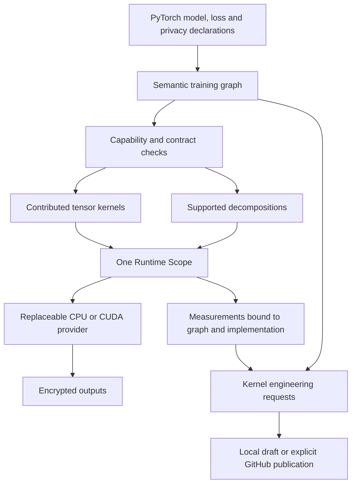

# Fhenomenon

Fhenomenon executes encrypted programs through explicit resource, scope and
kernel contracts. C++ and Rust implement the same runtime behavior; a Python
frontend captures fixed-shape PyTorch training graphs. Providers supply the
cryptographic implementation behind those contracts.

The model API, compiler, runtime, contracts and measurement tools are shared.
A kernel package can change the implementation and performance without requiring
a different model program. Contributions can cover an entire tensor operation or
a bounded span of commands, as well as individual CKKS operations.

## From a model to encrypted execution



The frontend captures forward computation, loss, activation backpropagation and
SGD updates of trainable parameters. Frozen weights still participate in
backpropagation. Unsupported secret operations fail before input encryption;
execution failures never trigger plaintext fallback. Fixed public control flow,
public approximation bounds and explicit privacy declarations are required.

A kernel request records geometry, visibility, numerical and resource conditions,
node coverage and selected implementation. Measured costs can support a
conditional estimate for replacing that work. The estimate is not a measured
speedup: a replacement that changes packing, levels or downstream work requires
recompilation and a new whole-program measurement.

The [issue-generation example](docs/kernel-engineering-issues.md) runs a small
encrypted training Scope, ranks measured contracts and creates or reuses a GitHub
issue. A [completed workflow run](https://github.com/zotanika/fhenomenon/actions/runs/43382483074)
generated [request #21](https://github.com/zotanika/fhenomenon/issues/21) for an
encrypted matrix multiplication, including its contract, measured cost and
acceptance conditions. This uses the insecure `NativeTest` fixture, not a
full-size model benchmark.

See [the model API](docs/model-compiler.md),
[tensor contribution contracts](docs/tensor-kernel-contributions.md) and
[provider replacement](docs/kernel-providers.md).

## Repository layout

| Directory | Responsibility |
| --- | --- |
| [`cpp/`](cpp/) | C++ runtime, CKKS providers, contributions, examples and tests |
| [`rust/`](rust/) | Independent Runtime and Scope; adapter to the shared CKKS C ABI |
| [`python/`](python/) | Model capture, semantic contracts, compilation, profiling and native bindings |
| [`contracts/`](contracts/) | Common runtime conformance fixtures |
| [`examples/openvla_training/`](examples/openvla_training/) | Complete scoped OpenVLA training example with reduced numerical fixtures |

Rust does not wrap the C++ Runtime or duplicate cryptographic kernels. The
current Python native binding uses the C++ tensor runtime. See
[language boundaries](docs/multi-language-runtime.md).

## Build and test

The default CPU build requires C++17 and CMake. Ordinary dependencies are fetched
by CMake; it does not require an external FHE library.

```sh
cmake -S . -B build -DCMAKE_BUILD_TYPE=Release -DBUILD_DOCUMENTATION=OFF
cmake --build build -j4
ctest --test-dir build --output-on-failure

# Use .dylib on macOS. Rust native tests require the built library.
FHN_NATIVE_TEST_LIBRARY="$PWD/build/lib/libckks_fhn.so" \
  cargo test --manifest-path rust/Cargo.toml --workspace

python -m pip install './python[ml]'
python -m unittest discover -s python/tests -v
```

The [Python reference example](python/examples/model_training.py) demonstrates
capture and kernel requests without cryptography. For real encrypted execution,
use the [native tensor provider](docs/kernel-providers.md). The Python native
binding currently requires Linux; the C++ and Rust runtime CI also covers macOS.

### CUDA provider

The reference CUDA implementation reuses pinned MIT-licensed Cheddar modular arithmetic and
NTT butterflies, adapted to Fhenomenon buffers, streams and ciphertext ownership.
It does not link the complete Cheddar library or its allocator. Attribution and
the exact reuse boundary are in [the CUDA source guide](cpp/providers/ckks_tensor/cuda/README.md).

```sh
git submodule update --init refs/cheddar-fhe
# Set the architecture for the target GPU; 121 is used for GB10.
cmake -S . -B build-cuda -DCMAKE_BUILD_TYPE=Release \
  -DBUILD_DOCUMENTATION=OFF -DFHN_BUILD_CUDA=ON -DCMAKE_CUDA_ARCHITECTURES=121
cmake --build build-cuda -j4
ctest --test-dir build-cuda --output-on-failure
```

CPU and CUDA expose the same tensor operation set, including target-level
ModRaise and slot/coefficient transforms. A larger operation need not be one GPU
launch. The [provider table](docs/kernel-providers.md#operation-coverage) states
which layer supplies each operation.

## Examples and extensions

- [OpenVLA training](examples/openvla_training/README.md): image encoders,
  projector, language decoder, loss, full backward graph and LoRA updates within
  one Scope. Numerical encrypted execution uses reduced randomly initialized
  models; the full 7B profile is shape capture only.
- [Encrypted document search](cpp/examples/private_search/README.md): encrypted
  document/query embeddings, reusable query preparation and block scoring.
- [Encrypted sensor analysis](cpp/examples/private_spectrum/README.md): complex
  cross-spectra, shared preparations and accumulated state across scopes.
- [Statistics](docs/coarse-statistics-kernels.md),
  [prepared matrix/vector work](docs/matvec-preparation.md) and
  [optional circuit compilation](docs/circuit-execution.md): contributions at
  different granularities using ordinary intermediate values.

The [lightweight runtime](docs/lightweight-runtime.md) owns bounded capture,
selection, resource identities, dependencies, output validation and diagnostics.
The older `FhnProgram` opcode interface and ToyFHE backend remain available for
reference execution and backend integration. ToyFHE is noncryptographic.

## Current limits

Contracts make supported conditions explicit; they are not proofs that arbitrary
kernel code is correct. Contributors are trusted code. Contract validation,
composition checks and numerical implementation tests have separate roles.
[The contract assurance boundary](docs/kernel-providers.md#contract-assurance)
describes what is checked and what remains a declared requirement.

The system is experimental. `NativeTest` is an insecure correctness fixture.
`Native128` applies a modulus-budget policy and is not an independent security
certification. Public approximation domains do not prove correctness for all
private inputs. Full-size encrypted model training, convergence, distributed key
custody, general scheme switching and automatic optimal graph partitioning are
not established by the examples.
