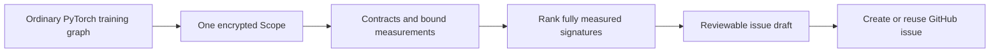

# From a measured Scope to a kernel engineering issue

The compiler can turn a measured semantic operation into a concrete engineering
request: its contract, current realization, observed cost, acceptance conditions
and reproduction evidence. The request does not prescribe a particular FHE
library or a decomposition into elementary operations. A provider can implement
the semantic operation as a larger kernel while preserving its contract.



## Live public example

The [example workflow](../.github/workflows/kernel-request-demo.yml) builds the
public CPU provider and runs [a small training fixture](../python/examples/kernel_issue_demo.py).
The fixture uses the ordinary model in `python/examples/model_training.py`: a
frozen linear layer and encrypted rank-1 adapters. Its forward pass, loss,
backward pass and SGD update execute in one Scope. Three runs check every final
loss, gradient and updated adapter against the captured PyTorch result before
emitting arithmetic-mean timings from that same sample cohort.

This is real encrypted execution using **NativeTest, an insecure numerical
fixture**. It is not OpenVLA/7B execution, a convergence result or a deployment
benchmark. No warm-up samples are discarded. It demonstrates the handoff from
model execution to an engineering request, rather than accelerator performance.

The workflow selects the highest-cost completely measured signature and posts
one issue. Source and workflow-run links, actual provider binary digests, the
cryptographic profile and application tolerances accompany the request. The
complete report and generated Markdown/JSON drafts are workflow artifacts,
retained for 30 days; download them for longer-lived evidence.

Automatic publication runs only when the public demo file changes on `main` of
a public non-fork repository. Private repository pushes and pull requests do not
publish issues. A manual run defaults to artifacts only; enable its `publish`
input to register the request. Only the publication job receives `issues: write`;
it consumes drafts with the standard-library client and does not install or run
model code. Authentication uses the repository's short-lived `GITHUB_TOKEN`.

## Local use and other models

From the repository root, with the SDK and native CPU provider built:

```sh
FHN_LIBRARY_DIR="$PWD/build/lib" \
  python -m python.examples.kernel_issue_demo \
  --output build/kernel-request-report.json
python -m fhenomenon.kernel_issues draft build/kernel-request-report.json \
  --output build/kernel-request-drafts
```

The same command accepts a successful `examples.openvla_training.run_training`
report containing `kernel_requests` and `kernel_cost_measurement`. It does not
upload that report. It extracts the selected compiler contract and bound timing
metadata. Use `--limit` for more drafts and `--context context.json` for reviewed
application context: `workload`, `hardware`, `limitations`, `numerical_acceptance`,
`reproduce`, `source_url` and `evidence_url`. Unspecified numerical requirements
remain unresolved acceptance conditions; timing evidence cannot infer them.

The corresponding model API is:

```python
from fhenomenon.ml import derive_kernel_issues

drafts = derive_kernel_issues(
    program.kernel_requests(), program.measurement(),
    context={"workload": "reviewed public fixture"}, limit=1,
)
```

Review the generated `.md` file, then inspect or explicitly publish its `.json`
counterpart. The first command is offline; the second uses `GH_TOKEN` or
`GITHUB_TOKEN` with Issues write permission for the named repository. Do not put
the token in command arguments or a committed file.

```sh
python -m fhenomenon.kernel_issues submit build/kernel-request-drafts/REQUEST_ID.json \
  --repository OWNER/REPO
python -m fhenomenon.kernel_issues submit build/kernel-request-drafts/REQUEST_ID.json \
  --repository OWNER/REPO --publish
```

Use only compiler-produced metadata artifacts. The exporter is not a general
secret redactor: architecture, operation arguments, environment and application
context may be proprietary even without weights or training values. Publication
must be a model-owner decision, not an implicit side effect of compilation.

## What the resulting issue establishes

- Matching artifact fingerprints, environment and implementation identities bind
  the timing to the request. Missing or partial timing coverage is never filled
  with estimated numbers; incomplete signatures are excluded from ranking.
- Ranking uses exclusive synchronized wall time inside the completed Scope.
  Input encryption, capture and final decryption are excluded. CUDA kernel time
  alone is not equivalent to this boundary.
- The reported maximum removable cost assumes zero replacement, setup and
  transfer time and unchanged surrounding work. It is an optimistic substitution
  bound, not a measured speedup. Concrete offers should use
  [`price_kernel_requests`](model-compiler.md#engineering-requests-and-measured-costs).
- Input/output geometry, visibility, arguments and live-outs define the semantic
  request. Layout, scale/level changes, keys, workspace and numerical ranges must
  be declared and checked for a proposed implementation. These requirements do
  not constitute a proof that arbitrary kernel code obeys its contract.
- A stable marker identifies the semantic contract, runtime requirements and
  application numerical acceptance. Graph/node names, timing fluctuations and
  binary/catalog revisions do not change it. Different profile or acceptance
  requirements create a different request. This is conservative equality, not
  logical equivalence checking.
- Repeat publication reuses an existing issue, including a closed one, without
  reopening it, overwriting human edits or sending another comment. The new
  measurement remains in the local/workflow artifacts. Workflow concurrency
  serializes publishers. Independent concurrent API callers can still race:
  GitHub offers no atomic create-if-absent issue API.

The [GitHub issue API](https://docs.github.com/en/rest/issues/issues#create-an-issue)
and [workflow token documentation](https://docs.github.com/en/actions/tutorials/authenticate-with-github_token)
describe the publication interface and repository-scoped authentication.
