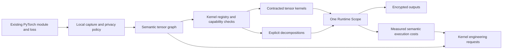

# Model programs and contributed kernels

The model frontend keeps tensor operations visible until a runtime implementation
is selected. A matrix multiplication can become one contracted tensor kernel or
an explicit decomposition. Model authors do not write CKKS rotations, level
alignment or ciphertext lifetime management in their model's `forward` method.

The current frontend captures a fixed-shape PyTorch training step: the model
forward pass, scalar loss, full backward pass and SGD updates of parameters
marked `requires_grad`. Frozen weights can still participate in activation
backpropagation. Capturing a graph does not mean its encrypted implementation is
supported or numerically valid.



## Model-facing API

Install `python/` with its `ml` extra. The runnable
[model example](../python/examples/model_training.py) uses an explicitly
noncryptographic backend to check integration without a native provider:

```bash
python -m pip install './python[ml]'
python python/examples/model_training.py
python -m unittest discover -s python/tests -v
```

An application supplies its model, loss and runtime-backed `TensorEngine`:

```python
from fhenomenon.ml import (
    capture_training, compile_model, native_tensor_registry, runtime_environment,
)

captured = capture_training(
    model, example_inputs, targets, loss_fn,
    input_visibility=("secret",),
    frozen_visibility="public",
    buffer_visibility="secret",
    learning_rate=1e-3,
)
program = compile_model(
    captured,
    registry=native_tensor_registry(),
    environment=runtime_environment(engine),
)
requests = program.kernel_requests()
bound_inputs = program.encrypt_inputs(engine, public_bound=declared_input_bound)
loss, gradients, updated_parameters = program.execute(engine, bound_inputs)
```

The visibility tree must match the input tree. Trainable parameters and targets
are secret by default. `frozen_visibility="public"` makes base weights visible to
the executor; use `"secret"` to encrypt them. Registered buffers default to secret
and accept a complete name-to-visibility mapping. Tensor constants captured from
model code require an explicit `constant_visibility="public"` declaration or
promotion to model inputs. Secret integer inputs require a separate oblivious
encoding; the compiler does not silently expose token indices.

Capture runs trusted model Python locally. It clones tensor state and preserves
the caller's RNG state; it is not a sandbox for arbitrary Python side effects.
Random or state-mutating training graphs are rejected until their randomness or
state transitions have explicit contracts. Dropout, running-statistic updates,
dynamic private control flow, arbitrary optimizers and arbitrary custom operators
are not supported merely because they work in PyTorch.

The semantic graph retains operator arguments, shapes, dtypes and visibility.
Unsupported secret operators are reported before input encryption. Graph changes,
input shape/dtype changes and a changed declared runtime environment require
recompilation. Public nodes may run on the host as declared specialization work.
Secret nodes use a selected kernel or an explicitly supported decomposition;
execution errors never trigger a plaintext fallback.

## Native encrypted execution

The [native tensor provider](kernel-providers.md) connects this API to CPU or CUDA
CKKS through `fhenomenon.backends.create_runtime_context`. Set `FHN_LIBRARY_DIR`
to its build or install directory. The [OpenVLA example](../examples/openvla_training/README.md)
uses that common path for a complete scoped forward/backward/update graph.
Changing providers does not require changing model code. Recompile and remeasure
for the selected provider; capability and numerical requirements still apply.

## Kernel contribution contract

The Python `KernelRegistry` accepts a `KernelDefinition` with a stable name,
version, supported semantic operations, requirements, matcher and executor.
Registration requires no interpreter switch. A program snapshots the registry;
changing registrations later does not change an existing program.

The matcher examines public metadata. The executor receives a `KernelContext`,
which supplies checked packing, native tensor submission and output construction.
The compiler checks output ownership, shape, dtype and public magnitude bounds.
Contributors are trusted implementation code, not an isolation boundary.

The standard `native.tensor.public_linear` adapter recognizes encrypted-activation
and public-weight `mm`/`addmm` operations whose input and output each fit one
packed ciphertext. The runtime must advertise `tensor.public_linear`. Bias and
nonunit alpha/beta scaling remain explicit scoped operations. Other geometry or
secret weights retain the general decomposition. This is a contracted operation,
not a promise of one CUDA launch.

The common C++ contribution interface lives in
[FHN/TensorKernels.h](../cpp/include/FHN/TensorKernels.h). It separates:

1. Pure public inference of output descriptors, keys, level/scale effects and
   conservative temporary storage.
2. Execution over immutable runtime values with checked output factories.
3. Atomic publication of all outputs after validation.

Actual arithmetic belongs to a provider's source or separately distributed
package. No external FHE implementation is required by the frontend or registry.
The general C++ and Rust Scope contracts also support multi-command kernels,
including live-out validation and fallback when an intermediate is exported.
The Python registry currently replaces one semantic operator at a time; arbitrary
cross-operator fusion and automatic optimal partitioning are not implemented.

## Engineering requests and measured costs

[The issue-automation example](kernel-engineering-issues.md) runs an encrypted
training Scope, ranks its measured semantic contracts and creates or reuses a
GitHub issue. The SDK also emits local Markdown/JSON drafts for review before
publication; compilation itself has no network side effects.

`program.kernel_requests()` groups secret operations by semantic signature. Each
request includes exact node coverage, input/output contracts, scalar keyword
arguments, selected implementation name/version, declined candidates and
acceptance requirements. Geometry is public to the executor and may itself
disclose a proprietary architecture. Review the artifact before sharing it.
It contains no parameter tensors, activations or training examples.

A profiling provider implements `semantic_node(name, signature, implementation)`
and records exclusive synchronized execution time for its recorded commands.
Capture time is excluded. Zero-command layout operations can have zero time;
final output materialization remains unattributed work in the measured whole
scope. Concurrent GPU-event durations cannot be substituted for additive wall
time without an explicit attribution method.

After a successful profiled encrypted execution, `program.measurement()` binds
the timings to the complete request fingerprint and runtime environment. Providers
without this capability return no measurement. Runtime profiles should identify
hardware, cryptographic parameters and actual provider binary revisions.

```python
from fhenomenon.ml import price_kernel_requests

estimate = price_kernel_requests(requests, program.measurement(), [{
    "signature": selected_request["signature"],
    "assumed_seconds_per_invocation": proposed_kernel_latency,
    "setup_seconds": additional_setup_per_scope,
    "transfer_seconds": additional_transfer_per_scope,
}])
```

The conditional duration is measured whole-scope duration minus the covered
measured duration, plus the proposed kernel duration and explicit additional
setup/transfer costs. Unmeasured requests remain unpriced. The estimator rejects
profile/signature/revision mismatches, overlapping node coverage, negative or
nonfinite costs and incompatible timing boundaries. A conditional estimate is a
development target, not a measured speedup or a guarantee of hardware feasibility.
The substitution estimate holds only if the replacement preserves the physical
boundary contracts and leaves downstream costs unchanged. A new packing, output
level/scale or refresh schedule can change other operations too; recompile and
measure that complete graph instead of treating it as an independent replacement.

## Implementation map and limits

| Path | Responsibility |
| --- | --- |
| `python/fhenomenon/ml/torch_frontend.py` | Model capture and privacy declarations |
| `contracts.py`, `program.py` | Semantic identity, validation and whole-Scope execution |
| `registry.py`, `kernels.py` | Contributor selection and native tensor adapters |
| `interpreter.py`, `tensor.py`, `approximations.py` | Explicit decompositions, packing and approximation contracts |
| `costs.py` | Measurement-bound conditional replacement costs |
| `cpp/include/FHN/TensorKernels.h` | Public native tensor contribution interface |
| `cpp/include/FHN/Scope.h`, `rust/fhenomenon/src/scope.rs` | Language-specific Scope execution contracts |

The reference backend checks algebra only. Real encrypted execution additionally
needs a provider with compatible primitives, target-level refresh, packing, keys,
memory accounting and numerical error contracts. Public approximation ranges are
requirements, not proofs for arbitrary private data. There is no claim here of
full-size model training, convergence, production security or a network-isolated
deployment. Python currently targets the runtime provider interface; a Python
binding to the independent Rust Runtime is not included.
