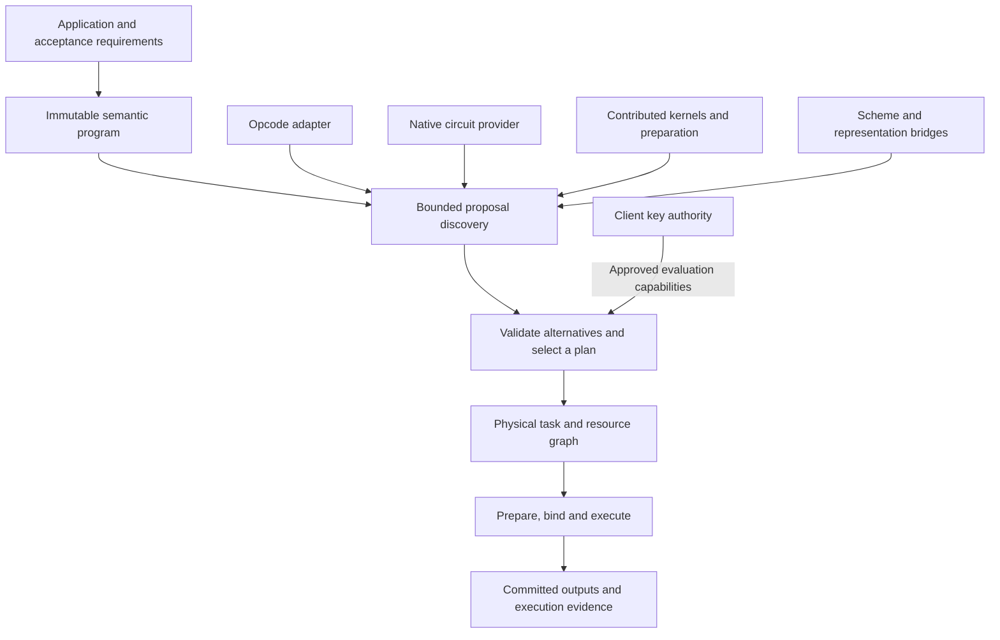

# Fhenomenon: an open runtime for contributed computation

> Superseded on 2026-10-31 by the
> [lightweight runtime design](2026-10-31-lightweight-runtime-design.md).
> This document records an abandoned global-planning proposal. Its mandatory
> DAG, search and admission machinery are not the implementation plan.
> Current code and limits: [lightweight runtime](../../lightweight-runtime.md).

Created: 2026-10-28. Finalized: 2026-10-30.
Status: reviewed redesign proposal, checked against the working tree.
This document specifies the next architecture. It does **not** claim that the
provider runtime, reusable-artifact ABI, or CGGI/CKKS/BFV bridges exist today.
Existing opcode execution and native circuit compilation remain implemented
baselines. Decisions below are the designer's recommendations under the user's
authorization to reconsider the architecture, not previously approved interface
details.

## Decision

Make the extension boundary a **proposal to realize part of a program under
explicit conditions**. An opcode implementation, a complete application kernel,
a reusable preparation step, and a conversion-plus-computation kernel can all
make proposals. The runtime selects compatible proposals and builds a physical
execution graph while preserving the original program's obligations.

The runtime owns composition, resource lifetimes, validation and selection.
Contributors own algorithms, matching rules and representation-specific
knowledge. The existing CKKS circuit compiler becomes one provider. Its
`Linear`, `ProductSum`, `Rotation`, etc. remain useful internal implementation
choices; they do not become the vocabulary every contributor must adopt.

The central invariant is:

> Splitting an implementation into several executable tasks must not erase the
> intermediate state, its consumers, or opportunities to reuse it. Combining
> tasks must not erase observable results or application requirements.

## 1. What the project is trying to achieve

The first README, commit `c30d914`, explicitly described contributed strategies,
subgraph dispatch, coarse kernels, data reuse and intermediate residency. The
current conversation confirms that intent. The aim is to let independently
contributed kernels at different granularities improve high-level programs.
Compatibility with familiar FHE operations is useful; unfamiliar contributions
must not have to impersonate an arithmetic opcode to participate.

The important scheme-crossing use case here is **CGGI/TFHE-style Boolean or LUT
computation combined with CKKS or BFV batched computation**. Symmetric-cipher
ingress is a separate possible application, not the premise of this redesign.
No claim is made that arbitrary parameterizations of these schemes interoperate.

Success has three distinct levels:

1. A kernel computes its declared result correctly.
2. Adding it can improve an unchanged, completely executed workload under the
   same requirements, including preparation, conversions and memory.
3. Its author can do this without editing the core planner or teaching the
   native compiler another private region kind.

The existing test and timing results establish parts of the first two levels
for the current corpus. They do not establish the third, nor adoption by a real
service. A benchmark's name does not establish its application relevance.

## 2. Diagnosis: where the current boundaries run out

| Evidence in the working tree | Consequence | Redesign |
| --- | --- | --- |
| `FhnKernelEntry` has opcode/function/name; `FhnDefaultExecutor` stores one function per opcode. | Multiple constrained implementations do not compete, and matching happens after boundaries are fixed. | Retain this ABI as a leaf adapter; register multiple proposals independently above it. |
| `FhnCircuitOp` is a fixed arithmetic catalog; `Circuit.cpp` selects six private execution kinds. | The compiler provides useful fusion but is the only authority on that fusion. | Treat this graph dialect and compiler as one semantic package and provider. |
| Native `Signature` and inferred outputs are private; `Compiler::import` requires actual certified ciphertext prototypes. | A host cannot analyze downstream regions before executing their predecessors. | Add metadata-only analysis and explicit output descriptors before composing regions. |
| Public boundaries expose ciphertext buffers; hoisted/decomposed state stays private or transient. | An opaque executable cannot advertise preparation shared by other tasks. | Make reusable artifacts and their dependencies explicit resources. |
| The legacy frontend selects a backend and its scheduler before execution. | One backend owns too many decisions; `belong()` cannot by itself establish a valid cryptographic bridge. | Separate the application program, provider instances, execution environments and key authority. |

Source anchors: `include/FHN/fhn_backend_api.h`,
`src/FHN/FhnDefaultExecutor.cpp:9`, `include/FHN/fhn_circuit_api.h`,
`src/CKKS/backend/Circuit.cpp:86`, `:310`, `:440`,
`src/CKKS/backend/BackendInternal.h`, `include/Session/Session.h`.

The original ambition was not inherently naive. The risky shortcuts were a
single backend owning the environment, one ciphertext representation per
logical value, and transparent conversion/parameter selection without explicit
preconditions. Those shortcuts conflict with the desired composition.

## 3. Alternatives considered

| Approach | Strength | Cost or limitation |
| --- | --- | --- |
| Extend the opcode table with constraints, estimates and multiple entries. | Small migration; makes alternative leaf kernels useful quickly. | A table alone cannot express shared preparation, multiple escaping outputs or alternative program decompositions. Adding these eventually needs another composition model. |
| Put optimization in a central extensible compiler and pass pipeline. | Strong global transformations; rich dialects can preserve high-level structure. | Contribution depends on compiler internals and pass ordering; provider-specific state and resource negotiation still need an explicit contract. Useful inside a provider or frontend. |
| Let providers propose realizations; select a physical task graph under workload requirements. | Accepts several granularities and algorithm families together; exposes reusable state and conversion costs. | Requires rigorous proposal validation and bounded search. Global optimality is not promised. |

Choose the third. Reuse the first as a compatibility provider and the second
where a provider benefits from compilation. This is an extension contract, not
a claim that graphs or compiler IR are undesirable.

## 4. The architecture



There are two graphs with different responsibilities:

- The **semantic program** states what values are required, their dependencies
  and allowed numerical behavior. Nodes may describe scalar arithmetic, a
  tensor operation, a lookup table, a domain algorithm or a nested region.
- The **physical plan** states which tasks create which ciphertext
  representations and artifacts, on which devices, using which capabilities.
  It includes preparation, conversion, transfers and release dependencies.

A semantic graph node is not an instruction. One task can implement many nodes;
several tasks can implement one node; preparation can implement no application
node at all. Neither graph is required to be a single-level arithmetic IR.

### 4.1 A workload contract precedes optimization

Each request has a versioned acceptance contract:

- immutable input/output meanings, shapes, packing interpretation and public
  parameters; whether inputs such as model weights are public or encrypted;
- exact modular/integer/Boolean semantics, or explicit approximate semantics,
  ranges, tolerances, failure-probability policy and required assurance level;
- required key domains, allowed evaluation capabilities, security profiles and
  public scheduling/leakage assumptions;
- permissible output representations and all outputs that must be retained;
- hard resource bounds and an objective: cold latency, repeated-call latency,
  throughput under a stated concurrency, or a named combination;
- expected reuse horizon and whether plan construction, key provisioning,
  encoding, encryption, movement and result decoding are inside the measured
  service boundary. Every excluded phase is still reported separately.

Ranges of encrypted values are supplied assumptions, not facts discovered by
inspecting ciphertexts. A deployment requiring adversarial-input validation
needs its own validation protocol; a descriptor is not a cryptographic proof.
An optimizer may not silently replace comparison by a polynomial, weaken
security, discard outputs, change an error bound or omit a conversion.

Numerical assurance has two explicitly different modes. `analytical_bound`
requires admitted quality-transfer rules or whole-plan analysis establishing
the requested bound under declared assumptions. `conformance_only` records
reviewed execution evidence for a named workload/profile/implementation envelope;
it does not establish a bound for every input in that envelope. The first native
runtime supports the latter for the existing regression workloads. A request for
the former fails with `quality_unverified` until adequate analysis is available.
Existing oracle passes must never be labeled universal error guarantees or a
cryptographic security certification.

### 4.2 Logical values, realizations and artifacts are separate

| Object | Meaning and identity |
| --- | --- |
| Logical value | An immutable versioned result in the semantic program, including its mathematical domain and shape. Mutable user variables are lowered to new versions. |
| Realization | A physical encoding of one or more logical values: scheme/parameters/key domain, component layout, slot mapping, level/scale or message domain, numerical guarantee, device and format owner. |
| Artifact | Reusable preparation with explicit producer, consumers, byte size, format, dependencies and lifetime. Examples: key-switch decomposition, encoded public weights or a repacking plan. It need not be a decryptable application value. |
| Capability | A checked evaluation requirement with state: present, authorized-and-provisionable, or unavailable/forbidden. It names a particular key relation, device service or format operation and never grants secret-key access. |

One logical value can have several realizations alive together. An LWE bundle
and a packed ciphertext are not automatically interchangeable. Their explicit
index mapping, signedness, message space and conversion guarantees must match.
Quantizing an approximate real into an integer creates a new logical value with
declared rounding/range behavior; it cannot masquerade as an identity cast.

Descriptors include namespaced, versioned format IDs and validated structured
payloads. The owning format package supplies interpretation and compatibility
checks. Unknown formats stay opaque; the core cannot infer interoperability
from a scheme name, JSON blob, pointer cast or matching ring dimension.

Providers may share a backend context if its owner explicitly permits that
format and buffer access. Supporting the same cryptosystem does not imply that
two libraries' ciphertexts or keys are mutually usable. A bridge or common
format implementation is required and its cost enters the plan. Initially,
several providers share one leased native context and its one client/key domain;
multiple key domains require separate contexts and an actual admitted bridge.

### 4.3 Semantic extensibility is explicit, not magical

A semantic package provides a stable identity/version, argument/result schemas,
type and range rules, a normative meaning, and conformance examples. It may
also provide approved decomposition rules into other semantic operations.
The first package imports the current circuit's value semantics. Physical
`MULT_CC`, explicit rescale and related FHN instructions retain their existing
contracts; they are not silently reinterpreted as semantic multiplication.

New domain operations are registered by packages. The runtime may execute a
native implementation of a high-level operation without decomposing it first.
If no implementation or admitted decomposition exists, it remains unsupported.

The initial executor admits pure logical computations and immutable artifacts.
An algorithm may take and return versioned application state as explicit values;
it may not mutate hidden semantic state or produce untracked external effects.
Provider cache updates cannot change meaning. Later effectful modules need
explicit state dependencies and commit/retry rules before admission; staging
ciphertext outputs alone would not roll back those effects.

Equivalence is an admission responsibility shared by semantic and provider
packages. The core checks structural validity, typed boundaries, policy and
resource rules; it is not a universal theorem prover. A provider's claim and a
reference-test pass are not proofs of cryptographic correctness. Unreviewed
third-party native code is not sandboxed by this API. Contributions are trusted
code with versioned conformance evidence, just as backend code is today.

### 4.4 What a provider contributes

Conceptually, a proposal has this form, not a finalized ABI layout:

```text
Offer {
  provider identity/version; semantic rule identity/version;
  source region and boundary value mapping;
  required input realizations, artifacts and capabilities;
  produced output realizations and reusable artifacts;
  numerical guarantees and validity conditions;
  resource/lifetime requirements;
  setup, execution, movement and memory cost evidence;
  immutable recipe for preparation and execution;
}
```

Discovery sees the public graph and descriptors, never decrypted inputs. It is
read-only, bounded by host-supplied enumeration limits, and may decline with a
structured reason. It does not generate keys, allocate device ciphertexts or
run speculative encrypted computation. Unknown cost is represented as unknown,
not zero. Provider-local compilation can be cached by graph/configuration hash.
The host bounds calls, accepted descriptors, proposals and search expansions.
In-process provider callbacks obey cooperative budgets; a hung callback is not
interruptible by these limits. Enforceable total planning deadlines require
process isolation or another explicitly interruptible provider protocol, outside
the first trusted-provider runtime.

The core validates all external operands and **escaping values** of a proposed
region. A consumed intermediate that is also an output or has a consumer outside
the region must remain available in the complete selected plan. The offer can
produce it, consume an already available realization, or coexist with a second
derivation whose computation and memory are charged. Requiring every offer to
produce every escape would incorrectly prohibit useful overlapping alternatives.

Proposals are alternatives, not destructive graph rewrites. Overlapping offers,
multi-output offers, separate preparation tasks and deliberate recomputation
are legal when the resulting plan meets every obligation. The selected physical
plan is a DAG of resources and tasks, not merely a non-overlapping node cover.
Matches may include disconnected sibling computations sharing an input; a region
is not required to be a contiguous range of FHN instructions.

### 4.5 Preserve reuse, including state that is not a ciphertext

An example future provider can expose:

```text
prepare_rotation_source(x at Q, key domain K) -> artifact H
rotate_prepared(H, g1, approved key Kg1)       -> realization r1
rotate_prepared(H, g2, approved key Kg2)       -> realization r2
consume(r1, r2, ...)                         -> output
```

The source preparation is represented once and charged once. A second provider
can instead offer a fused rotation bundle. Both can compete without the runtime
having an opcode named after the decomposition algorithm. Artifact compatibility
must be explicitly shared by the producers and consumers; opacity alone does
not create cross-provider interoperability.

Separate lifetime classes are essential:

- **Plan-scoped:** code, public constant transforms and schedule metadata, keyed
  by every relevant graph/configuration/constant version.
- **Key-scoped:** validated evaluation material and preparation, invalidated by
  the key-domain generation and context lifetime.
- **Binding-scoped:** any state derived from a particular ciphertext. Identity
  includes buffer generation, actual representation, owner and relevant keys.
  Re-encryption, rebinding or mutation invalidates it even if the plaintext or
  shape happens to be the same.

Raw addresses are not sufficient cache keys. Input handles are immutable within
an execution epoch; legacy mutable buffers receive new generations at import or
publication. Artifacts keep their dependencies alive until every consuming task
has completed. Sharing a prepared executable alone is not evidence of sharing
ciphertext-dependent preparation.

### 4.6 Selection must be bounded and inspectable

The initial planner is deterministic, serial and bounded. Discovery first
enumerates semantic matches without allocating ciphertexts. Starting from known
input descriptors, it analyzes matches whose input representation choices are
available as metadata, adding possible output descriptors and producer recipes.
Bound both the number of descriptor alternatives and provider calls. This is
metadata propagation, not execution; equivalent-looking descriptors do not make
their eventual ciphertext objects identical.

Then search backward from every required output over the discovered producer
recipes, retaining a bounded beam of alternative partial plans. Each partial
plan records chosen producers, unresolved inputs, shared artifacts and resource
dependencies. Resolve all inputs, reject cycles, and verify the complete physical
DAG before scheduling. A multi-output producer is charged once. An artifact is
bound to the exact selected producer/output port of its source, not any other
producer with a matching shape or logical value ID.

Candidate identity includes physical state, key capability and numerical
guarantee; a value ID alone cannot identify a planning state. Candidates that
miss hard requirements are rejected before ranking. For repeated execution,
rank setup plus the declared number of executions and movement, not an
unqualified per-kernel time. Compare resource peaks on the actual serial
schedule; shared preparation is charged once, and retaining it has a memory
cost. The first implementation does not claim global optimality or concurrent
device scheduling. Search limits and deterministic ordering are part of the
plan's recorded configuration; their initial tuning is an implementation choice.

Quality is checked for the **complete composed plan**. Each admitted analytical
rule states its assumptions on input ranges, error and failure policy, and
supplies a validated transfer to its outputs. Composing rules must account for
error amplification, correlations where relevant and accumulated failure policy;
the core must not add opaque scalar epsilons as a universal recipe. Unknown
composed quality cannot satisfy `analytical_bound`.

For the initial `conformance_only` mode, admission uses a reviewed manifest for
the complete numerical recipe: graph and public-attribute hash, input/range
assumptions, parameter/format versions, provider and rule versions, numerical
task dependencies, tolerances and test evidence. An alternative that changes
the numerical recipe needs its own conformance run and admission; it cannot
inherit the baseline's results. Rebinding compatible ciphertexts and reordering
independent tasks can reuse the same recipe evidence, without claiming all-input
proof. These manifests extend through the contribution registry, not core source
edits. Tests of metadata/planning alone never generate such evidence.

Always retain a validated baseline plan when one exists. A search limit means
`search_limit`, not proof that the program is impossible. Return the baseline
or another valid complete plan with this diagnostic. With no complete plan,
report the first unmet obligations and distinguish unsupported semantics,
unavailable capability, exceeded resource bounds and exhausted search budget.

Cost claims must carry their origin: measured, modeled, extrapolated or unknown.
Developer-supplied estimates do not establish a speedup. Automatic profiling
uses public fixtures or already-authorized workloads; it must not decrypt data,
run client actions secretly, or expand the visible scheduling policy.

Every plan produces a readable explanation: accepted/rejected offers, required
representations, preparation sharing, key requirements, conversions, reserved
bytes, expected reuse and measurement provenance. This makes an unfamiliar
kernel's contribution inspectable.

### 4.7 Prepare, bind, execute and publish

Analysis must precede ciphertext computation:

```text
describe input bindings -> certified public descriptors
analyze proposals       -> output descriptors and requirements
select                  -> complete feasible recipe
provision capabilities  -> separate trusted client action when needed
instantiate             -> allocated executable and preparation
bind                    -> validate actual buffers and artifact generations
execute                 -> task completion events
publish                 -> commit all requested outputs
```

Metadata-only analysis must use the same inference logic as execution. Native
CKKS currently requires real prototype buffers, so splitting that logic is the
first prerequisite, not something the generic planner can fake by executing
prefixes or manufacturing certified ciphertexts.

The first native provider SDK supplies opaque callbacks for descriptor
inspection, region analysis, immutable ciphertext views/leases, validated
evaluation-key/table capabilities and output allocation/publication. External
providers use these callbacks, not `BackendInternal.h`. The backend owns the
format and validates access. This demonstrates several providers in one native
domain; it does not claim portability across unrelated FHE libraries.

The initial runtime leases evaluation capabilities for a run and keeps secret
key access outside compute providers. Changing key domains requires an admitted
bridge and explicit provisioning policy. A provider cannot call the client's
decrypt/encrypt path to implement a conversion.

Selection can use an authorized-and-provisionable evaluation key if the trusted
key authority declares the exact key relation and supported provisioning
procedure. Its generation/loading cost and memory remain in the plan. Present
keys contribute their retention/loading costs as applicable. Unavailable or
forbidden relations make the offer infeasible. Provisioning occurs after
selection and can fail; the runtime then discards that preparation and selects
another authorized plan or reports failure before execution. Providers cannot
grant themselves provisioning authority or substitute another key identity.

Outputs use runtime-owned staging; successful completion publishes them as a
group. Input/output aliases cannot invalidate a live input or artifact. Failed
execution leaves caller-visible outputs unchanged, releases acquired resources,
and invalidates partial binding-scoped artifacts. Previously valid immutable
artifacts remain reusable only under their declared dependencies.

Fallback is allowed during analysis/preparation before publication. A failure
after tasks run must first quiesce tasks and discard staged results; only an
explicitly permitted whole-plan retry can use a different implementation.
There is no mid-flight substitution based on ciphertext contents. Async device
extensions must retain resources until completion, not until submission; the
first CPU runtime can satisfy that contract with immediate completion events.
Whole-plan retry in the first executor applies only to the pure, immutable-input
contract above and restarts from preserved bindings; it is not a guarantee of
rollback for arbitrary provider side effects.

Hard memory bounds apply to a declared accounting scope: I/O, intermediates,
artifacts, scratch, tables and evaluation keys must be separated and totaled
where owned or leased. Unknown external allocations prohibit a claim of a hard
total-memory bound. The current circuit workspace bound remains its narrower
slot-plus-scratch bound; it must not be relabeled as process memory.

## 5. Scheme switching tests the architecture

A future acceptance workload is encrypted scoring, a declared threshold or LUT,
then a masked batched aggregate. Its graph retains these meanings while offers
can place them in different schemes or combine conversion with computation.
Packing, extraction, key switching, LUT evaluation and repacking appear in the
physical plan with their actual requirements and costs. Neither conversion
direction is assumed available merely because the other is.

Keep two separate application contracts:

- Exact quantized scoring and thresholding: state the signed integer encoding,
  range, modulus/no-wrap conditions and tie behavior. A BFV/CGGI implementation
  must return exact results under its admitted correctness policy.
- Approximate scoring: state the CKKS error budget and the behavior allowed near
  the threshold. Exact agreement away from the boundary requires a justified
  margin greater than the admitted error. If exact decisions are required at
  the boundary, approximate metadata alone cannot satisfy the request.

These are different applications, not interchangeable benchmark variants. All
encrypted inputs, complete output layouts, cold and warm costs, crossing counts,
key bytes and peak live memory are included. A missing bridge is an explicit
unmet obligation. Current Toy comparison or plaintext ResNet examples do not
count as this workload running under encryption.

## 6. The first executable proof of the redesign

The first release should prove contribution and composition using real native
CKKS before attempting new cryptography. Preserve the current corpus graphs,
oracle and parameter/accuracy requirements.

### A. External region composition on `stats`

For each input dataset the existing graph returns both
`s = sum(x)` and `v = 64 * sum(x*x) - s*s`. `s` escapes as an output and also feeds
another computation. This is an unnormalized dispersion expression; for 64
elements it is `64^2 * population_variance`, not an already normalized variance.

Build a separately loaded reduction provider and allow it to coexist with the
native circuit provider for the residual graph. Also admit a multi-output
provider for `(s, v)`. Neither registration modifies the planner, source graph
or private native fusion switch. Validate all four original outputs and all
their slots, not a selected scalar or a changed statistical formula.

An independently loaded provider must be removable without changing the
application. If a legal baseline exists, its removal selects that baseline.
Trace evidence must show which provider owns every boundary and how `s` remains
available. This proves extensibility; wrapping the identical compiler and
renaming it does not establish a new optimization.

### B. Reusable preparation on the existing rotation fan-out

The `matvec` corpus graph rotates one input many ways. It is a circulant-style
scalar-weighted rotation sum, not a general dense encrypted matrix multiply.
Use this unchanged graph to test a genuinely reusable rotation-source artifact,
multiple consumers, memory pressure and rebinding. A proposed hoisting algorithm
must first be validated with identical ciphertexts and keys; no algebraic or
speedup claim follows from defining an artifact handle.

A conservative first experiment retains inverse-NTT coefficient limbs of the
source component and reuses them across rotations. Keep per-rotation conversion
and switching until their equivalence is established. Full basis-extension
hoisting through automorphisms needs separate rounding/canonical-representative
analysis and differential tests; it is not assumed by this architecture.

Test both a separate preparation/consumer implementation and a fused bundle.
The trace must show one preparation shared by several consumers, its bytes and
last consumer, and invalidation on fresh encryption of the input. Under a tight
budget, retaining every artifact may lose to recomputation or the baseline.
Such a result is legitimate; it must not be hidden by the planner.

### C. Unchanged genuine encrypted matrix application

`matvec-fused` already takes eight encrypted rows and one shared encrypted vector
and returns eight row dot products. Keep this independent application check as
the catalog changes. It exercises several outputs and shared inputs without
allowing the planner to replace encrypted weights by public constants.

Together A, B and C establish different properties. A shared value, a shared
prepared executable, and a shared ciphertext-dependent artifact are distinct
claims and need distinct evidence.

### Required adversarial cases

| Case | Required result |
| --- | --- |
| Fused offer swallows `s` although another consumer needs it | Reject that plan or include an explicitly charged surviving derivation. |
| Two providers require incompatible layouts or key domains | Include an admitted bridge or report unmet requirements. Never cast handles. |
| Different ciphertext rebound with identical shape | Reuse the plan, invalidate input-dependent artifacts. |
| Multi-output proposal overlaps a smaller candidate | Choose a complete derivation; never double-publish inconsistent realizations. |
| Fast candidate has unavailable key or excessive live memory | Select another legal plan or explain failure before running. |
| Provider returns malformed boundaries, cycles or unknown contracts | Reject before preparation. |
| Search budget exhausted | Keep a validated baseline when available; distinguish from unsupported. |
| Preparation or execution fails | Preserve public outputs and release/retire resources according to completion. |
| Only part of an application is executable | Application fails acceptance; report partial coverage separately. |

Record three paired comparisons where applicable: current direct compiler,
catalog with baseline provider only, and catalog with contributions. This
separates runtime overhead from kernel benefit. Measure completed work with
unchanged inputs, parameters and tolerances, report cold and warm phases, and
record unsupported cases. A slower new provider remains inspectable but is not
promoted as an optimization on manufactured costs.

## 7. Migration order and stop conditions

1. **Separate native analysis from instantiation.** Add public descriptor
   inspection and metadata-only region analysis with inferred outputs, key
   requirements and resource reports. Share inference with the existing compile
   path. Verify descriptor predictions against actual execution and retain all
   existing arithmetic, lifetime and output-transaction tests.
2. **Introduce the catalog and bounded CPU planner.** Implement immutable
   program/offer/resource descriptions, provider registration and a single
   baseline adapter. Preserve multi-output and representation distinctions from
   the start. Existing programs still use their original path unless explicitly
   routed to the new runtime.
3. **Prove independent region contribution.** Build the separately loaded `stats`
   provider and residual composition. Adding/removing its library must require
   no core edits. If this fails, fix the boundary before adding providers.
4. **Prove non-value state reuse.** Add the rotation preparation experiment with
   real dependency generations, leases and memory accounting. Do not label
   ordinary buffer reuse or executable caching as this milestone.
5. **Integrate a real frontend and application requirements.** Adapt Session or a
   higher-level builder with immutable values, explicit acceptance requirements
   and diagnostics. Preserve high-level operation structure where available.
6. **Admit scheme bridges and asynchronous devices independently.** Implement
   actual cryptography and formats under the same contracts. Run the complete
   mixed workload before advertising CGGI/CKKS/BFV interoperability.

Steps 1–4 together are the minimum architecture proof. A successful `stats`
adapter alone does not establish preservation of reusable non-value state.
Detailed workload boundaries and checks are in
[open-kernel acceptance](../../open-kernel-acceptance.md).

Do not freeze a large permanent C ABI before steps 1–4 expose its missing
information. Keep public handles opaque, structures size/version tagged and
ownership explicit; initially version the new API independently of FHN ABI 1.
The separately loaded proof must use that documented boundary, not include
`BackendInternal.h` or depend on private planner classes.

## 8. Tradeoffs that stay visible

- Arbitrary granularities do not imply arbitrary automatic equivalence. Trusted
  semantic rules and conformance evidence are a contribution cost.
- Opaque implementations do not imply zero-copy interoperability. Shared
  formats or explicit adapters are necessary.
- Transparent user programming does not erase choices about precision, ranges,
  key relationships and allowed disclosure. Named policies can package them.
- Reuse consumes memory; fusion can prevent useful sharing. Neither always wins.
- Runtime selection means selection at public specialization/preparation
  boundaries, with cheap repeated execution. It does not require rediscovering
  a plan for every arithmetic call.
- FHE-native programming may require application changes. These changes and
  their maintenance burden belong in adoption evidence, rather than disappearing
  behind a kernel benchmark.

## 9. What changes in the project's claim

The op table remains a useful way to contribute a small implementation. The
native compiler remains useful and its measured improvements remain real within
their reported conditions. Neither is sufficient as the sole ecosystem boundary.

The new claim to earn is concrete: an independently contributed implementation,
including its preparation and representation constraints, can improve an
unchanged complete workload while coexisting with other implementations. The
runtime can explain its selection and preserve the states needed by every
consumer. The first implementation milestones above are designed to make that
claim falsifiable.

## 10. Review and delivery scope

An independent Astra architecture review and a separate implementation-readiness
review checked this design. The review corrections now included are:

- Complete-plan numerical admission, with explicit distinction between
  analytical bounds and the initial conformance-only evidence.
- Pure logical computations, explicit application-state values and immutable
  artifacts; no implied rollback of hidden provider side effects.
- Bounded host search distinguished from cooperative in-process callbacks.
- Present versus authorized-and-provisionable key capabilities, including cost,
  authority and provisioning failure.

The final architecture review reported no remaining material inconsistency;
the implementation-readiness reviewer reported no important unanswered question
for planning. These are design-review outcomes, not executable validation.

This redesign delivery changes documentation only: this specification, the
acceptance cases, and pointers/context in README and the vision archive. New
runtime implementation and its performance remain to be established by the
migration milestones. Existing implementation validation is not rerun or
reclaimed as evidence for these proposed interfaces.
